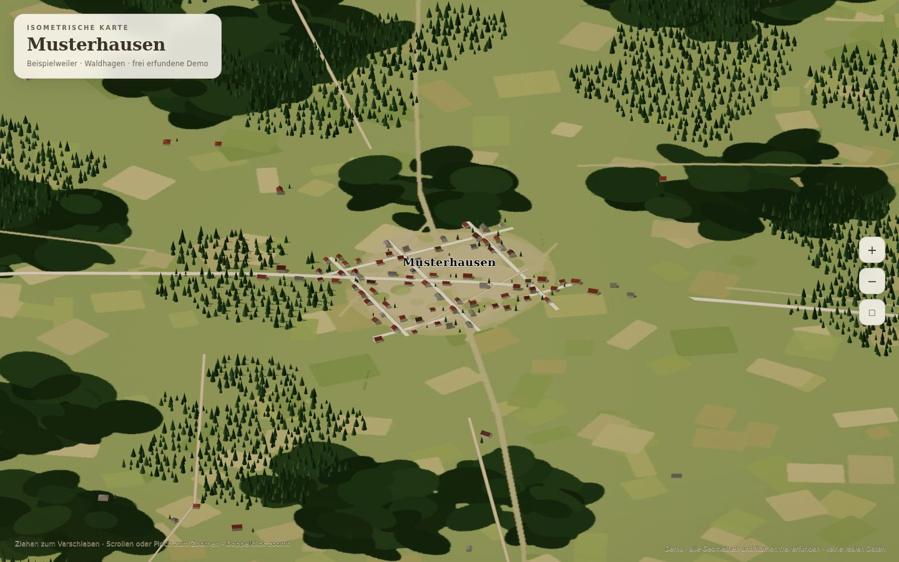

# Isometrische Dorfkarte

Ein statischer Kartengenerator: aus offenen Geodaten (OpenStreetMap, LoD2-Dachformen,
Höhenmodell, Orthofoto) entsteht eine **illustrative isometrische Karte**, die im
Browser frei verschoben und gezoomt werden kann. Kein Backend, keine Datenbank,
keine externen Anfragen zur Laufzeit: Three.js ist mitgeliefert, alle Daten liegen
als Dateien im Projekt.



*Die Demo „Musterhausen“ ist vollständig frei erfunden (Namen, Geometrien, Bild).*

---

## Was das Projekt macht

- **Gelände** aus einem Höhenraster als geglättetes Mesh mit Diorama-Sockel
- **Gebäude** aus OSM-Grundrissen, automatisch typisiert (Walm-/Satteldach, Firstrichtung,
  Wand- und Dachfarben je Gebäudetyp)
- **LoD2-Dachformen** optional: echte Dachflächen aus amtlichem CityGML ersetzen die
  typisierten Dächer und werden am Gelände verankert
- **Straßen** aus OSM als Kassettenbänder mit typabhängiger Breite, exakt auf die
  Bbox zugeschnitten
- **Bäume** aus der Waldmaske des Bodenbildes, als InstancedMesh (~30 k Bäume, 1 Draw Call)
- **Ortsnamen** als skalierende Label-Sprites
- **Orthofoto** als gemalter Untergrund (Median, entsättigt, aufgehellt, quantisiert)
- **Bedienung**: Ziehen = verschieben, Scrollen/Pinch = zoomen, Doppelklick = näher,
  `◻` = Gesamtansicht; orthografische Iso-Kamera, keine Rotation

---

## Schnellstart (Demo)

Voraussetzung: Python 3, sonst nichts. Node wird **nicht** benötigt.

```bash
cd web
python3 -m http.server 8000
# http://localhost:8000/
```

> Wichtig: über HTTP starten, nicht per `file://` – `meta.json` und `height.json`
> werden per `fetch` geladen.

Die Demo-Daten liegen bereits in `web/data/`. Neu erzeugen (deterministisch, Seed 7):

```bash
python3 tools/make_demo.py
```

`make_demo.py` erzeugt Gelände, Felder, Wälder, Straßen, 177 Gebäude (davon 74 mit
synthetischen LoD2-Dächern), Ortsnamen und ein gemaltes Bodenbild – **ohne jede
reale Geodatenquelle**. Damit ist das Repository vollständig anonym.

---

---

## Proxmox: Als LXC hosten (Einzeiler)

Auf einem Proxmox-VE-Host (als root) installiert ein Einzeiler das Projekt als
unprivilegierten LXC-Container (2 vCPU, 2 GB RAM, 8 GB Disk, Port 8000, `onboot`,
systemd-Service, Demo-Dorf sofort live):

```bash
bash -c "$(wget -qLO - https://raw.githubusercontent.com/HatchetMan111/DigitalTwinLokal/main/install/digitaltwinlokal.sh)"
```

Der Installer **fragt interaktiv nach dem Gebiet** (Dorf-/Ortsname + Radius, leer
= nur Demo). Wer es scriptgesteuert bevorzugt, übergibt das Gebiet direkt per
Flag — beide Wege enden im gleichen Ergebnis: Nach dem Bau ist das Dorf im
Dorfregal als **3D- und 2D-Karte** erreichbar, vollautomatisch aus offenen
Geodaten gebaut.

Danach gilt: `http://<CT-IP>:8000/` = **Dorfregal** (Übersicht aller Dörfer) und
je Dorf `<dorf>/` = 3D-Ansicht, `<dorf>/karte.html` = **2D-Karte**. Im Heimnetz
kann jedes Gerät von oben aufs Dorf schauen – komplett lokal, ohne Cloud.

### Use Cases

| Befehl (auf dem Proxmox-Host) | Was passiert |
|---|---|
| *(Einzeiler oben)* | CT erstellen + Demo-Dorf „Musterhausen“ hosten |
| `…digitaltwinlokal.sh --dorf "Dein Dorf"` | **Echtes Heimatdorf vollautomatisch erstellen**: OSM-Gebäude/Straßen (Overpass), Höhenmodell (AWS-Terrarium-Kacheln z13), Luftbild (Esri World Imagery z16), gemalter Boden – landet direkt im Dorfregal |
| `… --dorf "Dein Dorf" --radius 2000` | Größerer Ausschnitt; `--bbox w,s,e,n` wählt die Region exakt |
| `… --dorf "Nachbardorf"` | Weitere Dörfer hinzufügen (beliebig oft, alles im Regal) |
| `… --list` | Gehostete Dörfer mit URLs auflisten |
| `… --export "Dein Dorf" --out /root/dorf.tar.gz` | Dorf als tar.gz auf den Host sichern |
| `… --remove-dorf "Dein Dorf"` | Dorf aus dem Container entfernen |
| `… --update` | App-Code aktualisieren (Dorf-Daten bleiben erhalten) |
| `… --status` | Service, Dörfer und Erreichbarkeit prüfen |
| `… --uninstall` | Container vollständig entfernen |

Container-Feinsteuerung: `--id`, `--hostname`, `--storage`, `--rootfs`, `--cores`,
`--memory`, `--ip`, `--port`, `--tiles` (eigene Kachelquelle, z. B. Bayern-Orthofotos),
`--z`, `--title`, `--subtitle`, `--attribution`, `--debug` (vollständiges `bash -x`-Log).
Bei Fehlern gibt das Script die komplette Fehlerkette inkl. Container-Logs aus;
ein vollständiges Installationslog liegt unter `/tmp/digitaltwin-installer-*.log`.

Hinweise: Beim Dorf-Bau lädt der Container **einmalig** OSM-, Höhen- und
Luftbilddaten aus dem Internet (Overpass/AWS/Esri); die fertige Web-UI läuft danach
komplett lokal. Echte Ortsdaten bleiben ausschließlich im Container – nichts davon
landet in diesem öffentlichen Repo. Die Attribution ist vorbelegt und erscheint
sichtbar in jeder Karte.

---

## Eigenes Dorf bauen

Der Ablauf ist für Mensch und KI-Agent identisch. Details und Dateiformate stehen in
[`AGENTS.md`](AGENTS.md), die technische Referenz in [`docs/PIPELINE.md`](docs/PIPELINE.md).
Benötigt werden nur Python 3 und Pillow (`pip install pillow`); `numpy` nur für
SRTM-Kacheln, `rasterio` nur für GeoTIFF-Höhenmodelle. Node ist nicht nötig.

**An den KI-Agenten übergeben:** Repository (oder ZIP) plus diesen Prompt:

> Lies `AGENTS.md` und `docs/PIPELINE.md`. Baue mit diesem Projekt eine isometrische
> Karte für `<Ortsname>` (Bbox: `<w,s,e,n>` oder Radius `<m>`). Orthofoto:
> `<XYZ-Template oder Datei>`, Höhenmodell: `<GeoTIFF/SRTM oder „keins“>`,
> LoD2: `<Verzeichnis oder „keins“>`. Titel: `<…>`, Attribution: `<…>`.
> Halte dich an die Invarianten, verifiziere mit einem Screenshot (Desktop + Mobil)
> und melde am Ende die erzeugten Dateien und Messwerte.

```bash
# 1) OSM-Gebäude, Straßen und Ortsnamen laden (bbox wird mitgeschrieben)
python3 tools/fetch_osm.py --name "MeinDorf" --radius 1600
#    alternativ ohne Geokodierung:
python3 tools/fetch_osm.py --bbox 11.49,48.09,11.54,48.13 --title "MeinDorf"

# 2) Gelände + Untergrundbild
python3 tools/build_scene.py \
  --tiles "https://DEIN-KACHELSERVER/{z}/{x}/{y}.jpg" --z 16 \
  --srtm-dir /pfad/zu/srtm13 \
  --title "MeinDorf" --subtitle "Gemeinde Beispiel" \
  --attribution "© OpenStreetMap-Mitwirkende · Orthofoto © …"

#    ohne Kachelserver, mit bereits zugeschnittenem Luftbild:
# python3 tools/build_scene.py --ortho-file /pfad/luftbild.jpg --dem-geotiff /pfad/dgm.tif

# 3) Bodenbild malen (optional, sonst rohes Orthofoto)
python3 tools/stylize_ground.py

# 4) LoD2-Dachformen (optional)
mkdir -p data/lod2 && cp /pfad/*.gml data/lod2/
python3 tools/build_lod2.py
#    ohne LoD2: build_scene.py legt automatisch einen leeren Stub an
#    (alternativ: echo 'window.LOD2={b:[]};' > web/data/lod2.js)

# 5) starten
cd web && python3 -m http.server 8000
```

**Mindestanforderung ist nur Schritt 1** (plus `meta.json`/`height.json`, die
`build_scene.py` schreibt). Ohne Orthofoto wird der Boden einfarbig mit feiner
Textur; ohne Höhenmodell flach; ohne LoD2 werden Dächer typisiert – die Karte
funktioniert in jedem Fall.

### Welche Daten brauche ich?

| Ebene | Quelle | Pflicht | Lizenz/Hinweis |
|---|---|---|---|
| Gebäude, Straßen, Ortsnamen | OpenStreetMap (Overpass) | ja | ODbL – Attribution „© OpenStreetMap-Mitwirkende“ |
| Orthofoto | Landesvermessung / DOP20, WMS/XYZ | optional | je Bundesland, meist dl-de/by-2-0 |
| Höhenmodell | DGM1/DGM5 als GeoTIFF oder SRTM | optional | je Quelle |
| LoD2-Dachformen | AdV-CityGML deines Bundeslandes | optional | Open Data, Quelle in `meta.attribution` nennen |

Der Kachelserver ist **nicht** fest verdrahtet: `--tiles` nimmt ein beliebiges
XYZ-Template (`{z}/{x}/{y}`), z. B. einen WMS-/DOP-Dienst deines Landes. Bitte
Nutzungsbedingungen und Attribution der Quelle einhalten.

---

## Aufbau

```
iso-village-map/
├── web/                     ← ausgelieferte App
│   ├── index.html           HUD, Importmap, Daten-Skripte
│   ├── iso.css              Papier-/Chip-Design, Mobilregeln
│   ├── iso.js               Three.js-Szene, Kamera, Datenaufbau
│   ├── vendor/three/        three.js r186 (lokal, keine CDN-Abhängigkeit)
│   └── data/
│       ├── buildings.js     window.BUILDINGS (GeoJSON)
│       ├── roads.js         window.ROADS
│       ├── places.js        window.PLACES
│       ├── lod2.js          window.LOD2 (optional, sonst Stub)
│       ├── bbox.json        Gebietsgrenze (Artefakt von fetch_osm.py)
│       └── scene/
│           ├── meta.json    bbox, Titel, Attribution, Fokus
│           ├── height.json  Höhenraster 161×161
│           ├── ortho.jpg    Rohbild (optional)
│           └── ground.jpg   gemaltes Bodenbild
├── tools/
│   ├── fetch_osm.py         OSM laden (Overpass, GET + User-Agent)
│   ├── build_scene.py       Orthofoto + Höhenraster + meta.json
│   ├── stylize_ground.py    Bodenbild-Stil
│   ├── build_lod2.py        CityGML → lod2.js
│   └── make_demo.py         frei erfundene Demo (anonym)
├── docs/
│   ├── PIPELINE.md          technische Referenz (Mathematik, Fallstricke)
│   └── screenshots/
├── AGENTS.md                Anleitung für KI-Agenten (Pflichtlektüre)
├── LICENSE                  MIT (nur Code)
└── README.md
```

---

## Datenformate (Kurzfassung)

Alle Daten sind JavaScript-Globals, damit sie ohne Bundler und ohne CORS-Tricks
geladen werden können. Koordinaten in `buildings.js`, `roads.js`, `places.js` sind
`[lat, lon]` bzw. GeoJSON `[lon, lat]`; die App rechnet in lokale Meter um.

```js
window.BUILDINGS = {type:'FeatureCollection', features:[{
  type:'Feature',
  geometry:{type:'Polygon', coordinates:[[[lon,lat], …]]},
  properties:{osm_id, building, area_m2, width_m, depth_m,
              street, near_street, village, levels, addr}
}]};

window.ROADS  = [{t:'residential', p:[[lat,lon], …]}];
window.PLACES = [{name:'MeinDorf', kind:'village', lat, lon}];
window.LOD2   = {src:'…', off:0, n:1, b:[{
  i:'id', o:'osm_id', x:0, y:0, z:0,
  p:[/* Dreiecke in cm, relativ zu x/y/z */], k:'rww…'   // r=Dach, w=Wand
}]};
```

`meta.json` steuert Titel und Startansicht:

```json
{
  "w": 11.498, "s": 48.098, "e": 11.532, "n": 48.122,
  "img": [1500, 1586],
  "title": "Musterhausen",
  "subtitle": "Beispielweiler · Waldhagen · frei erfundene Demo",
  "eyebrow": "Isometrische Karte",
  "attribution": "© OpenStreetMap-Mitwirkende · …",
  "focus": {"lat": 48.11, "lon": 11.515, "radius": 300}
}
```

`focus` ist der Startausschnitt (Mittelpunkt + Radius in Metern). Fehlt `focus`,
wird die ganze Bbox gezeigt.

---

## Performance

Richtwerte der Demo (1440×900, SwiftShader-Headless):

- ~10 Draw Calls, ~270 k Dreiecke, davon ~6.900 Bäume in **einem** InstancedMesh
- Gebäude und LoD2 sind je **ein** Mesh (vertex colors), Straßen ein Mesh
- Labels sind Sprites, Schatten nur für Bäume/Gebäude, Shadow-Camera folgt dem Ziel

Für große Gebiete (mehrere km²) gilt: Bäume werden über die Fläche verdünnt, nicht
abgeschnitten; die Draw-Call-Zahl bleibt konstant. Das Bodenbild sollte ≤ 2000 px
breit bleiben (Dateigröße).

---

## Bekannte Grenzen

- Keine Rotation/Perspektive (bewusst: feste Iso-Richtung, orthografisch)
- Kein Picking/keine Detailkarten (bewusst: reine Ansicht)
- Orthofoto ist eine gemalte Abstraktion, kein Vermessungsprodukt
- LoD2 nur, wenn die Quelle AdV-CityGML mit `RoofSurface`/`WallSurface` liefert
- Sehr steile Hänge: Gebäude werden am Gelände verankert, Wände bis zum Boden gezogen;
  bei extremen Hanglagen können Kanten leicht „schwimmen“

---

## Anonymisierung

Dieses Repository enthält **keine** Daten eines realen Ortes:

- Demo-Orte (`Musterhausen`, `Beispielweiler`, `Waldhagen`) und alle Geometrien sind
  synthetisch, erzeugt von `tools/make_demo.py` (Seed 7)
- keine echten Koordinaten, keine echten OSM-IDs, keine Screenshots realer Orte
- `fetch_osm.py` und `build_scene.py` erzeugen bei Bedarf echte Daten – diese gehören
  dann **nicht** ins öffentliche Repository, sondern nur in die lokale Installation

Wenn du deine echte Karte veröffentlichst: prüfe die Lizenz deiner Orthofoto-/LoD2-
Quelle und nimm die geforderte Attribution in `meta.json` auf.

---

## Lizenz

Code: MIT (siehe `LICENSE`). Mitgelieferte Daten der Demo: frei erfunden, keine
Rechte Dritter. Three.js steht unter MIT (siehe `web/vendor/three/LICENSE`).
Für selbst eingebundene Geodaten gelten deren Lizenzen (OSM: ODbL).
